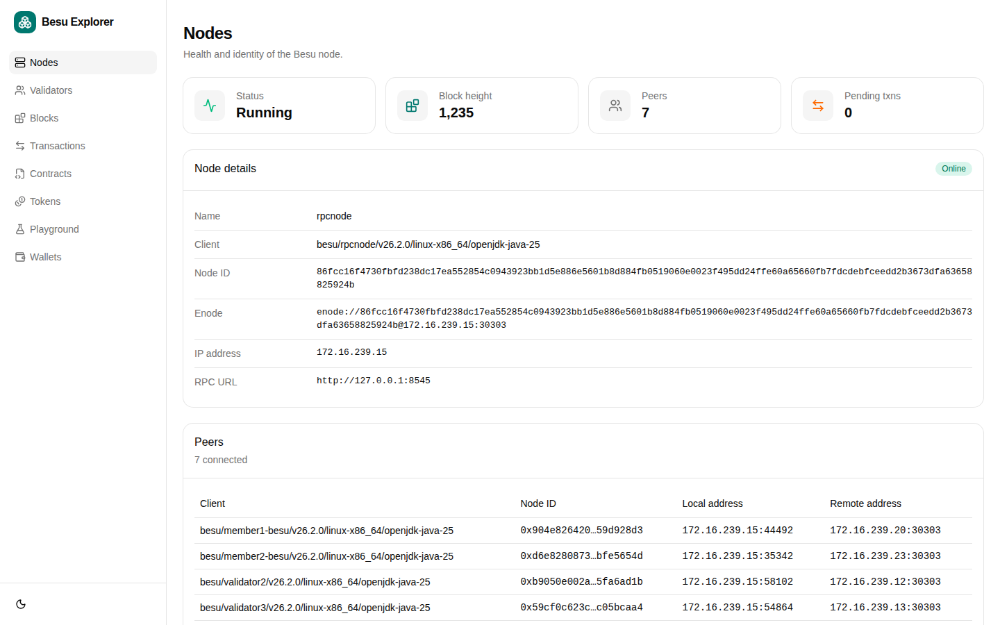
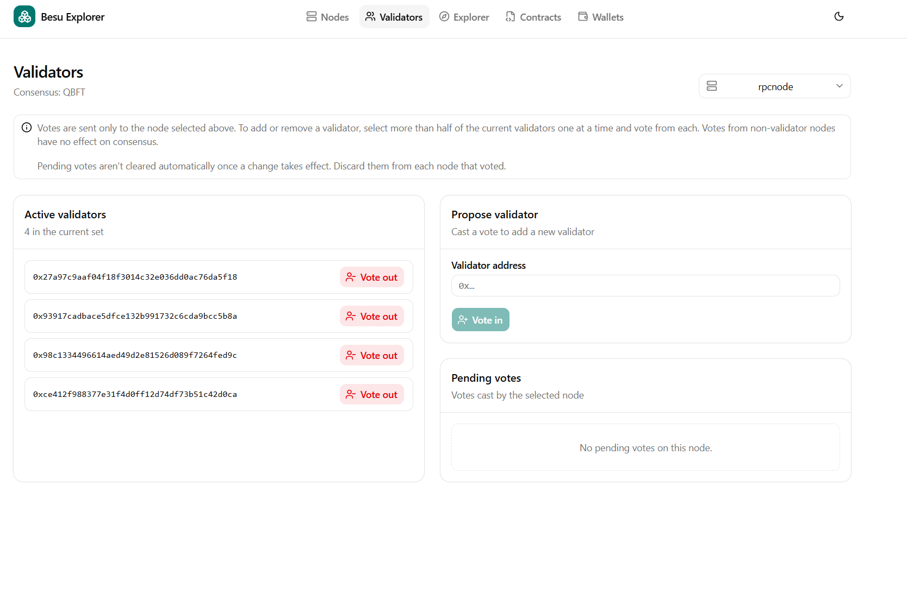
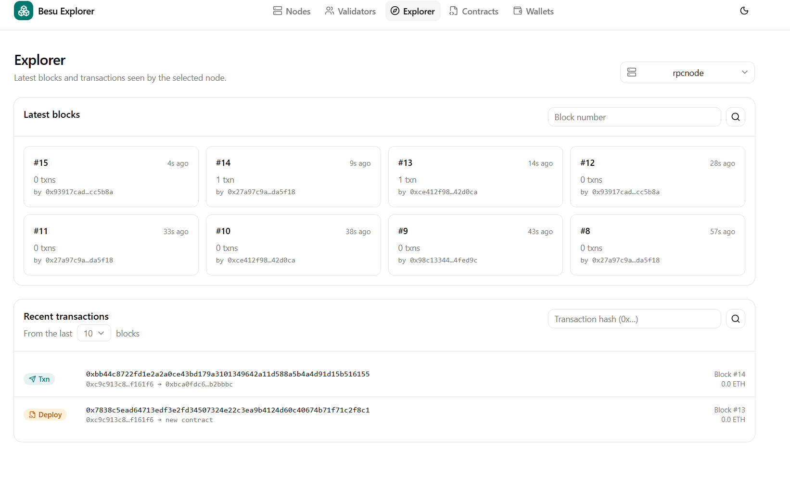
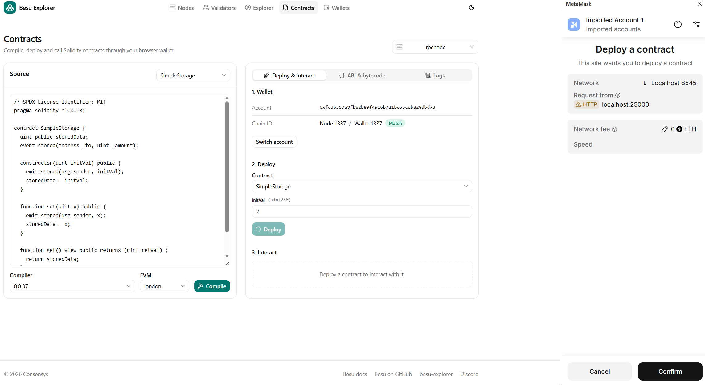
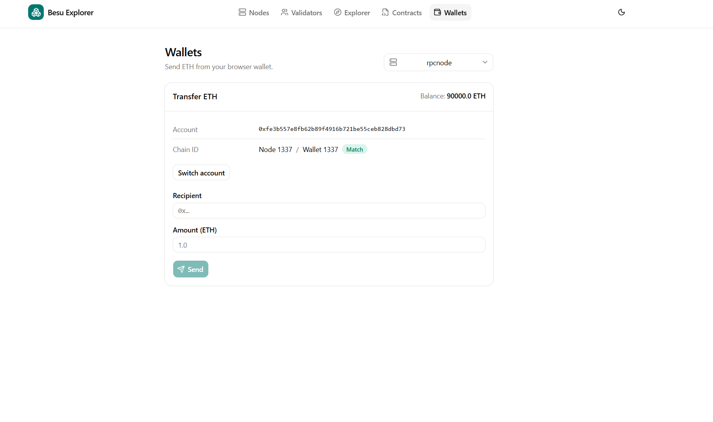

# Besu Explorer

> [!TIP]
> For a full working setup with a Besu network and the explorer, see the [Besu Dev Quickstart](https://github.com/Consensys/besu-dev-quickstart). For more on Besu itself, see the [Besu documentation](https://docs.besu-eth.org/).

A lightweight explorer for private [Hyperledger Besu](https://docs.besu-eth.org/) networks. It gives you a quick overview of your chain without the setup cost of a full indexer such as Blockscout:

- **Nodes**: status, block height, peers, pending transactions and node identity

  

- **Validators**: view the validator set with node names (QBFT, IBFT 2.0 and Clique), also propose or discard votes. This should be only used on demo/test networks and never in production.

  

- **Explorer**: latest blocks and transactions, with lookup by block number or transaction hash

  

- **Contracts**: compile Solidity in the browser, then deploy and call contracts through MetaMask

  

- **Wallets**: send ETH through MetaMask

  


It has not been designed for production use yet.

## Tech stack

Next.js 16 (Pages Router), React 19, TypeScript, Tailwind CSS v4, [shadcn/ui](https://ui.shadcn.com/), ethers v6 and NextAuth.

## Prerequisites

- [Node.js](https://nodejs.org/) 24 LTS
- [Docker](https://www.docker.com/) (optional)
- A Besu network, for example from the [Besu Dev Quickstart](https://www.npmjs.com/package/@consensys-software/besu-dev-quickstart)

The explorer reads from a single node. Enable these JSON-RPC API groups on it with `--rpc-http-api`:

| API group | Used for |
| --- | --- |
| `ETH`, `NET` | blocks, transactions, chain ID, peer count |
| `ADMIN` | node info, peer list and validator names |
| `TXPOOL` | pending transaction count (optional) |
| `QBFT`, `IBFT` or `CLIQUE` | the validators page (match your consensus) |

## Configuration

Point the explorer at a node with `BE_RPC_URL`, for example `http://rpcnode:8545`. Every page reads from this node, and it must be reachable from the explorer's server.

The explorer works the rest out from the chain:

- **Consensus**: detected from whichever of the `QBFT`, `IBFT` or `CLIQUE` APIs the node answers.
- **Node names**: start each Besu node with `--identity=<name>`, for example `--identity=validator1`. The explorer shows that name for the node and its peers. Validators are matched to names by address, for the node itself and its directly connected peers.

The server only proxies requests to the configured RPC URLs, and only for an allow-list of RPC methods.

### Validator voting (demo networks only)

> [!WARNING]
> Only use this on demo and test networks, never in production. It needs each validator's RPC endpoint and lets anyone signed in to the explorer vote validators in or out.

Proposing or discarding a validator vote has to be sent to each validator's own RPC endpoint. To enable voting, provide a file listing them at `/config/validators.json`, or set `BE_VALIDATORS_CONFIG_PATH` to another path. The [Besu Dev Quickstart](https://www.npmjs.com/package/@consensys-software/besu-dev-quickstart) includes one for its network:

```json
{
  "validators": [
    { "name": "validator1", "rpcUrl": "http://127.0.0.1:21001" },
    { "name": "validator2", "rpcUrl": "http://127.0.0.1:21002" }
  ]
}
```

- `rpcUrl`: the validator's HTTP JSON-RPC endpoint, reachable from the explorer's server. Enable the `QBFT`, `IBFT` or `CLIQUE` API on it.
- `name` (optional): the label in the validator picker. Defaults to the URL's host.

Without this file, the validators page is read-only.

## Local development

1. Use `.env.local` in the project root and update the vars as needed

2. Start the app:

   ```bash
   npm install
   npm run dev
   ```

3. Open <http://localhost:25000/explorer>.

Other scripts: `npm run build`, `npm start`, `npm run lint` and `npm run typecheck`.

### UI components

UI primitives live in `src/components/ui` and come from shadcn/ui. To add another one:

```bash
npx shadcn@latest add <component>
```

## Production

Enable authentication in production. Set the values in `.env.production`:

- **NEXTAUTH_SECRET** (required): generate one with `openssl rand -hex 32`.
- **DISABLE_AUTH**: set to `false` to require sign-in. You then need at least one provider configured below.
- **BE_ALLOWED_DOMAINS** or **BE_ALLOWED_EMAILS** (required for OAuth): who may sign in. See [Restricting sign-in](#restricting-sign-in).

### Options

| Variable | Description |
| --- | --- |
| `BE_BASEPATH` | URL base path, default `/explorer`. Baked in at build time. |
| `BE_RPC_URL` | HTTP JSON-RPC endpoint of the Besu node the explorer reads from. Required. |
| `BE_PUBLIC_RPC_URL` | RPC URL given to the browser wallet when it adds the network. Defaults to `BE_RPC_URL`. Set it when browsers can't reach `BE_RPC_URL`, for example when that's an internal hostname. |
| `BE_VALIDATORS_CONFIG_PATH` | Path to the validators file that enables voting, default `/config/validators.json`. Demo networks only. See [Validator voting](#validator-voting-demo-networks-only). |
| `DISABLE_AUTH` | `true` turns authentication off. Any other value requires sign-in. |
| `NEXTAUTH_URL` | Public URL of the auth API, including the base path, for example `https://example.com/explorer/api/auth`. |
| `NEXTAUTH_SECRET` | Secret used to sign sessions. |
| `BE_ALLOWED_DOMAINS` | Comma-separated email domains allowed to sign in through OAuth, for example `consensys.net`. |
| `BE_ALLOWED_EMAILS` | Comma-separated email addresses allowed to sign in through OAuth, in addition to the domains. |
| `local_username`, `local_password` | Simple username/password sign-in, convenient for testing. Not recommended for production. |

OAuth providers are enabled when all of their variables are set: GitHub, GitLab, Google, Facebook, Twitter, Auth0, Azure AD, Atlassian, Cognito, Okta and Slack. See `.env.production` for the variable names. You can enable several at once, and the sign-in page lists them all.

When you create the OAuth app with a provider, register this callback URL:

```text
<NEXTAUTH_URL>/callback/<provider>
```

For example, `https://example.com/explorer/api/auth/callback/github`. The provider IDs are `github`, `gitlab`, `google`, `facebook`, `twitter`, `auth0`, `azure-ad`, `atlassian`, `cognito`, `okta` and `slack`. `.env.production` lists each one's callback URL next to its variables.

### Restricting sign-in

An OAuth provider proves who someone is, not that they should have access. Enabling Google, for example, would otherwise let in any Google account. So OAuth sign-ins are denied unless the account's email matches `BE_ALLOWED_DOMAINS` or `BE_ALLOWED_EMAILS`:

```bash
BE_ALLOWED_DOMAINS=consensys.net
BE_ALLOWED_EMAILS=contractor@example.com
```

- Both are comma-separated and case-insensitive.
- Domains match exactly: `consensys.net` doesn't admit `sub.consensys.net` or `evil-consensys.net`. List subdomains separately.
- If neither is set, every OAuth sign-in is denied and the server logs a warning at startup.
- Accounts without an email (some Twitter and Facebook accounts) can't sign in. Neither can accounts whose provider reports the email as unverified.
- For Azure AD, set `AZURE_AD_TENANT_ID` to your directory (tenant) ID rather than `common`, so only accounts in your organisation can sign in.
- The allow lists don't apply to `local_username` and `local_password`, which whoever deploys the explorer sets.
- Denied sign-ins are logged with the email and provider.
- Sessions end after 8 hours without using the explorer. Removing someone from a list doesn't end a session they already have; that happens after 8 idle hours, or straight away for everyone if you rotate `NEXTAUTH_SECRET`.

### Docker Compose

```yaml
services:
  explorer:
    image: consensys/besu-explorer:latest
    environment:
      BE_RPC_URL: http://rpcnode:8545
    volumes:
      - ./.env.production:/app/.env.production
    ports:
      - 25000:25000/tcp
```

`.env.production` **must** be provided. Variables set in `environment` override it.

For a demo network with voting, also mount the validators file at `/config`:

```yaml
    volumes:
      - ./validators.json:/config/validators.json:ro
```

### Building your own image

The image is based on Ubuntu 26.04 with Node.js 24 LTS and runs as a non-root user.

```bash
docker build . -t YOUR_IMAGE:TAG
```

`BE_BASEPATH` is read from `.env.production` at build time. Rebuild the image if you change it.

## Troubleshooting

### Deploying a contract fails with an invalid opcode

Solidity 0.8.20 and later targets the Shanghai EVM by default and emits `PUSH0`. If your genesis doesn't enable Shanghai, pick an older target such as `london` or `paris` from the **EVM** selector on the Contracts page. The default is `london`.

### MetaMask transaction is stuck

This happens when you reuse a MetaMask account after resetting your network, because the account's nonce no longer matches the chain.

**Back up your private keys or seed phrase before doing this.**

1. Select the account in MetaMask.
2. Go to **Settings → Advanced** and click **Clear activity tab data** (previously "Reset account").
3. Repeat for each account used on the network, then retry the transaction.

## Contributing

We welcome PRs for bugs or new features. Please sign the CLA and submit a PR for review. If you raise an issue, include steps to reproduce it.
